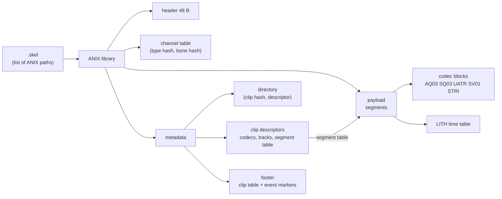
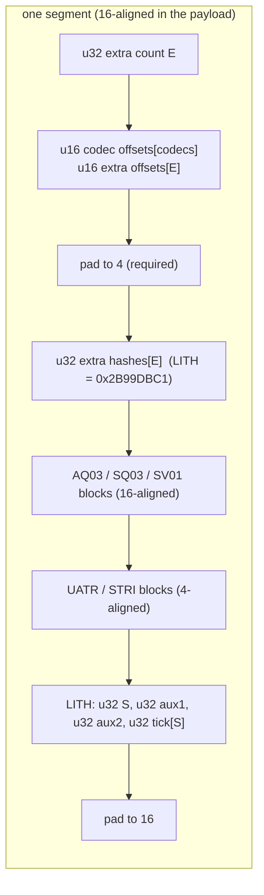
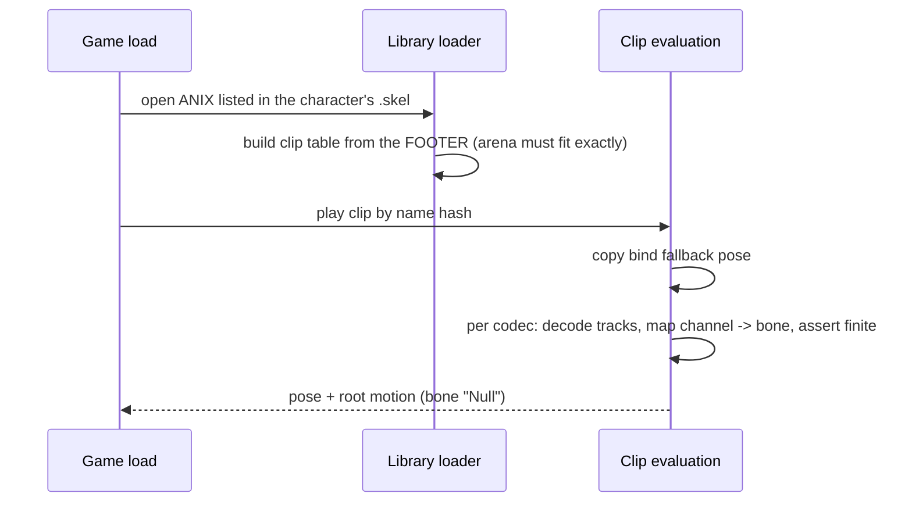

# Shadow of War `.anix` format (ANIX v44)

A community specification of the animation libraries used by *Middle-earth: Shadow of War* (PC), plus a small
reference decoder in Python.

- The format was reverse-engineered from the retail executable.
- It was checked against **1,017 native libraries** (17,283 clips, 18,623 segments).
- It was proven in practice: libraries written from this spec load and play in game, both new clips appended to native libraries and private libraries with 50+ retargeted clips.

This repository contains **no game data**.

| Path | Content |
|---|---|
| `README.md` | the specification (below) |
| `reference/anix.py` | reader + decoders (AQ03, SQ03, SV01, UATR, STRI), engine-exact NaN check, encoders for packed quaternions and UATR |
| `tests/test_codecs.py` | synthetic tests (no game files) |

```bash
pip install numpy
python reference/anix.py path/to/library.anix
```

## At a glance





**Packed quaternion: one 42-bit slot, three slots per 16-byte word**

| bits | 0–12 | 13–25 | 26–38 | 39–40 | 41 |
|---|---|---|---|---|---|
| field | component a | component b | component c | `3 − omitted index` | sign of omitted |



---

## 1. Conventions

| Item | Value |
|---|---|
| Space | Y-up, centimetres |
| Quaternions | `x, y, z, w` |
| Time ("ticks") | milliseconds. The 30 fps frame grid is `floor(k * 100 / 3)` (0, 33, 66, 100, 133…) |
| Names | ASCII, NUL-terminated. Clip names are at most 47 characters |
| Root motion | carried by the bone `Null` (its `Pos` and `Rotation` channels) |

### Name hash

Clip names, bone names, channel types and block tags are identified by a 32-bit hash. It is case-insensitive because the character map folds `A-Z` and `a-z` together.

```python
CHAR_MAP = bytes.fromhex(
    "0000000000000000000000000000000000000000000000000000000000000000"
    "253a333c3d3e403242434128362737341b1c1d1e1f2021222324313038293935"
    "3b0102030405060708090a0b0c0d0e0f101112131415161718191a2c2a2d3f26"
    "440102030405060708090a0b0c0d0e0f101112131415161718191a2e2b2f4500")

def name_hash(name: str) -> int:
    h = 0
    for c in name.encode("ascii"):
        h = (h * 0x397 + CHAR_MAP[c]) & 0xFFFFFFFF
    return h
```

| Name | Hash |
|---|---|
| `Rotation` (channel type) | `0x27436396` |
| `Pos` (channel type) | `0x00CE66FC` |
| `LITH` (segment time table) | `0x2B99DBC1` |
| `KeyString` (descriptor extra: event strings) | `0xB9010BE0` |
| `bind` (bind-pose clip) | `0x5CFA71ED` |
| `Null` (root bone) | `0x88BAA7E7` |
| event channel type (name unknown) | `0x210C8F5A` |
| float channel type, read by CAF4 (name unknown) | `0x5F1D8EED` |

---

## 2. File layout

```
+--------------------+  0
| header (48 B)      |
+--------------------+  channel table offset (always 48)
| channel table      |
+--------------------+  payload offset (16-aligned)
| payload: segments  |
+--------------------+  metadata offset = payload offset + payload size
| metadata:          |
|   head (16 B)      |
|   clip directory   |
|   clip descriptors |
|   footer           |  <- always ends the file
+--------------------+  file size
```

### 2.1 Header (48 bytes)

| Offset | Type | Value |
|---|---|---|
| 0 | char[4] | `ANIX` |
| 4 | u32 | version = 44 |
| 8 | u32 | header size = 48 |
| 12 | u32 | file size |
| 16 | u32 | channel count |
| 20 | u32 | channel table offset (48) |
| 24 | u32 | payload offset |
| 28 | u32 | payload size |
| 32 | u32 | metadata offset (= payload offset + payload size) |
| 36 | u32 | metadata size (metadata offset + metadata size = file size) |
| 40 | u32 | 1 (all natives) |
| 44 | u32 | 1 (all natives) |

### 2.2 Channel table

The table is a sequence of groups that continues until `channel count` channels have been listed:

```
u32 type hash        Rotation / Pos / event type / float type
u32 n
u32 bone hash[n]     name_hash(bone name)
```

A channel's index is its position across all groups (0, 1, 2…). Clips refer to channels by this index. The table belongs to the library and is shared by every clip in it.

---

## 3. Metadata

Every metadata offset is relative to the **metadata start**. The payload can therefore grow without rewriting the metadata.

### 3.1 Head (16 bytes)

| Offset | Type | Value |
|---|---|---|
| 0 | u32 | directory offset = 16 |
| 4 | u32 | clip count |
| 8 | u32 | 0 |
| 12 | u32 | footer offset |

### 3.2 Directory

There are `clip count` entries of `(u32 clip-name hash, u32 descriptor offset)`. The directory does **not** need to be sorted: 900 of the 1,017 natives are unsorted, and the engine scans it linearly. The first descriptor starts at `align16(16 + 8 * clip count)`, and every descriptor is 16-aligned.

### 3.3 Clip descriptor

| Offset | Type | Field |
|---|---|---|
| 0 | char[48] | clip name, NUL-padded |
| 48 | u16 | header size = `124 + 16 * segments + 8 * extras` (true for every native clip) |
| 50 | u16 | flags: bit 0 picks which bind-fallback buffer is used (0 in 17,249 clips, 1 in 34) |
| 52 | u16 | segment count |
| 54 | u16 | extra count (descriptor extras such as `KeyString`) |
| 56 | u16 | codec count |
| 58 | u16 | track count |
| 60 | f32[7] | root at start: `Null` position xyz + quaternion xyzw |
| 88 | f32[7] | root at end (the clip's total root motion) |
| 116 | u32 | **unknown**: 0 in 97 % of clips; otherwise a tick value on the 30 fps grid (33, 133, 200, 600…) |
| 120 | u32 | duration, ticks |
| 124 | char[4] × codec count | codec FourCCs (`AQ03`, `SQ03`, `UATR`…) |
| … | u8 × track count | codec index of each track |
| (align 4) | u16 × track count | channel index of each track (no duplicates; need not be sorted) |
| (align 4) | 16 B × segment count | segment table: `u32 payload offset (payload-relative, 16-aligned), u32 length, u32 first tick, u32 last tick` |
| … | 8 B × extra count | extras table: `u32 hash, u32 offset from descriptor start` |
| … | | extra data, e.g. `KeyString` = the event strings this clip's STRI blocks point into |
| (pad 16) | | |

Segments must be contiguous: each segment's first tick equals the previous segment's last tick.

---

## 4. Segments (payload)

Each segment is 16-aligned inside the payload and holds every track of one clip over its time range.

```
u32  extra-block count E        natives: 1 (LITH); 0 when the segment has no LITH
u16  codec block offset[codec count]     (segment-relative)
u16  extra block offset[E]
pad  to 4 bytes                          <- required, even with an even codec count
u32  extra block hash[E]                 0x2B99DBC1 = LITH
...  codec blocks, in descriptor codec order
       AQ03 / SQ03 / SV01 blocks: 16-aligned (segment-relative)
       UATR / STRI blocks: 4-aligned
     LITH block (4-aligned):
       u32 sample count S
       u32 aux1, u32 aux2           (0 in written files; when set, aux1 * 6 bytes then aux2 follow the tick table)
       u32 tick[S]                  first = segment first tick, last = segment last tick, non-decreasing
pad  to 16
```

A codec block runs from its offset to the next block's offset; the last one ends at the LITH offset.

- **u16 offsets:** a segment must stay under 64 KiB. Long clips are split into several segments.
- **When LITH is required:** UATR reads its key times from the LITH table. The engine looks the table up by hash. If it is missing or misaligned, UATR silently writes nothing and the translations are dropped. AQ03, SQ03 and SV01 do not need LITH.

---

## 5. Codecs

| FourCC | Kind | Native use |
|---|---|---|
| `AQ03` | animated quaternions | 15,867 clips |
| `SQ03` | static quaternions | 15,549 |
| `UATR` | animated vectors (translations) | 17,143 |
| `SV01` | static vectors | 9,667 |
| `STRI` | event strings on the timeline | 14,742 |
| `AV01`, `UAQT`, `UAVT`, `USBT`, `USFT`, `CAF4` | **not decoded** (rare: 94 / 26 / 26 / 26 / 26 / 2 clips) | |

### 5.1 Packed quaternion (shared by AQ03 and SQ03)

Each 16-byte little-endian word (u128) holds **three** quaternions of 42 bits each, at bits 0, 42 and 84. Bits 126–127 are unused.

```
bits  0-12  component a (13 bits)
bits 13-25  component b
bits 26-38  component c
bits 39-40  m = 3 - index of the omitted component   (0 omits w, 1 omits z, 2 omits y, 3 omits x)
bit  41     sign of the omitted component (1 = negative)

value  = u / 8190 * sqrt(2) - sqrt(0.5)        (float32 constants)
omitted = sqrt(1 - a^2 - b^2 - c^2), negated if bit 41 is set
the three stored components keep their x, y, z, w order around the omitted one
```

Encoder: omit the component with the largest magnitude, flip the quaternion's sign so that component is positive, then quantise the other three.

> **Crash rule.** The engine decodes **all three slots of every word, including unused padding slots**, without clamping, and asserts that no value is NaN. When the track count is not a multiple of 3, fill the spare slots with the native identity filler `a = b = c = 4095, metadata 0`. A zeroed slot gives `1 - 1.5 < 0`, so `sqrt` returns NaN and the game crashes with `EvaluateBlockAQ03 decoded NAN`.

### 5.2 SQ03 (static rotations)

One packed row of `ceil(T / 3) * 16` bytes for `T` tracks. It is constant over the segment.

### 5.3 AQ03 (animated rotations)

```
u32 start tick
u32 end tick
u32 key count K   (>= 2)
u16 delta[K]      delta[0] = 0, others > 0; start + sum(deltas) = end
pad to 16 (block-relative)
K packed rows, each ceil(T / 3) * 16 bytes
```

The key times are independent of the LITH table and need not be uniform.

**Evaluation:**
1. Clamp the time to the key range.
2. Take the bracketing keys.
3. Flip the upper key if `dot < 0` (shortest path).
4. Linearly interpolate, then normalise (**nlerp**, not slerp).

### 5.4 SV01 (static vectors)

One u32 per track, then padding to 16 bytes:

```
x = bits  2-11, y = bits 12-21, z = bits 22-31   (bits 0-1 unused)
value = u / 1022 * 512 - 256       (centimetres; range ±256)
```

### 5.5 UATR (animated vectors)

UATR has no time table of its own: it uses the segment's LITH ticks, `S` samples.

```
u16 track start[T]           block-relative; the table is padded to 4 bytes; each start is 4-aligned
per track:
  S x (u8 control index, u8 fraction)
  pad to 4
  N x f32[3] control points  (N >= 2; N = (next track start - controls start) / 12)
```

**Evaluation at time `t`:**
1. Find the bracketing LITH samples `i, i+1` and the fraction `f`.
2. Set `lo = frac[i] / 255`. If `index[i+1] == index[i]`, set `hi = frac[i+1] / 255`; otherwise `hi = 1.0`.
3. Compute `w = lo + (hi - lo) * f`.
4. The result is `lerp(control[index[i]], control[index[i] + 1], w)`.

**Exact encoder:** use one control per sample, `(i, 0)` for sample `i`, and `(S - 2, 255)` for the last sample. The evaluator then reproduces each sample exactly and interpolates linearly between them. Because the index is a u8, a segment can hold at most 256 samples with this layout.

### 5.6 STRI (timeline events) + `KeyString`

```
u16 2
u16 total string bytes
u32 event count
u16 0
event count x (u32 tick, u16 offset, u16 length incl. NUL)   offset into the clip's KeyString extra
pad to 4
```

- STRI is bound to one channel of the event type (`0x210C8F5A`), on bone `Null` in natives.
- The strings themselves live in the descriptor extra `KeyString` (`0xB9010BE0`).
- A clip with several segments repeats the full STRI block in every segment.

---

## 6. Footer: the library's clip table (required)

At load time the game builds its clip table from the footer, **not** from the directory. The footer starts at metadata `head[12]` and runs to the end of the file.

```
u32 h[6]
  h[0] stream offset          (body-relative)
  h[1] total frames           (sum of record.frames)
  h[2] total event markers    (markers whose tag != 0xFF)
  h[3] total markers          (sum of record.N)
  h[4] event-string table offset (body-relative)
  h[5] stream size
body:
  [0, h4)        names: the library's own path (e.g. characters\animationcharacters\...\x.anix), then the clip names
  [h4, h0)       event strings, NUL-terminated, deduplicated for the whole library
  [h0, h0 + h5)  stream:
      41-byte stream header: u32 (= h[0] - 5 in every native), u8, f32[3], f32[4], u32, u32
      one record per DIRECTORY clip, in directory order:
         f32[3] extents            (40, 104, 40 is typical; 0 for bind)
         u32    name offset       (body-relative, points into the names)
         u32    unknown (the loader keeps the low 16 bits; 0 works)
         u32    unknown (0 works)
         u32    unknown (0 works)
         u32    flag (0)
         u32    frames            = size of the clip's time grid (below)
         u32    N                 = marker count (>= 1)
         u32    mark[N]           index of each marker in the time grid
         u32    marker[N]         (event tag << 24) | tick; tag = index in the event-string table, 0xFF = no event
      12 zero bytes
```

- **Time grid:** the 30 fps ticks `floor(k * 100 / 3)` for `k = 0 … round(duration * 0.03)`, merged with every marker tick that is not already on the grid. `frames` is the size of this grid and `mark[i]` is the position of marker `i` in it. This holds for 95 % of native clips; the exceptions are mostly prototype libraries. The loader itself only needs the totals in `h[]` to match the records.
- **Markers:** the first one is at tick 0, and in 92 % of native clips the last one sits at the clip duration. New clips should follow both rules.
- **Tag limit:** the tag is 8 bits and 0xFF is reserved, so a library can hold at most **255 distinct event strings**.
- **Checked on all 1,017 natives:**
  - one record per directory clip, in directory order;
  - `h[1]`, `h[2]` and `h[3]` equal the sums over the records;
  - the stream header's first u32 is `h[0] - 5`;
  - the footer ends the file.

> **Crash rule.** The loader sizes an arena of `8 * (h[2] + h[3] + 10 * clip count)` bytes, reads exactly one record per directory clip and asserts that the arena is consumed exactly. A clip present in the directory with no matching footer record, or wrong totals in `h[]`, crashes the game **at load**.

Event strings in player libraries are gameplay and audio keys. Examples:
- **Hit windows:** `BCOL` / `APPLYDAMAGE` / `ECOL`.
- **Combo window:** `BUFFTRANS` / `AEE`.
- **Gameplay:** `APPLYBUFF`, `AOE`.
- **Audio:** `vx_*`, `fts_*`, `fol_*`.
- **Foot phases:** `HeelStrike`, `ToeStrike`…

---

## 7. How the game uses a library

- **Clip lookup:** a character plays clips **by name**. Its `.skel` lists the ANIX paths it may use; Talion's `player_base.skel` lists about 2,780. A new library must be added to that list once, and its bundle must be loaded.
- **Name collisions:** clip names must be unique across all the libraries a character uses.
- **`bind` clip:** every library has one. At initialisation the engine evaluates it at time 0 into a fallback pose. When a clip is evaluated, that pose is copied first and only the clip's own tracks overwrite it. Channels a clip does not animate therefore keep the bind pose, and descriptor flag bit 0 chooses between the two fallback buffers.
- **Evaluation:** for each codec, the engine gathers that codec's tracks and maps each channel index to a bone of the current skeleton (unmapped channels are discarded), then calls the codec evaluator. It asserts that every value is finite.
- **Root motion:** the root moves through the `Null` bone. The descriptor's root start and end hold its transform at the first and last key.

---

## 8. Checklist for writing a valid library

1. Write the header sizes and offsets correctly. Keep the payload and every segment 16-aligned.
2. Pad the segment header to 4 bytes before the extra-hash table, and include LITH whenever you use UATR.
3. Use `align16` relative to the block for the AQ03 key rows. Fill the spare quaternion slots with the identity filler (`4095, 4095, 4095, 0`).
4. Set the descriptor header size to `124 + 16 * segments + 8 * extras`, and make segment ticks contiguous.
5. Give every directory clip exactly one footer record, in the same order, and keep the `h[]` totals exact.
6. Keep at most 255 event strings per library and clip names under 48 bytes.
7. To validate, re-decode every block with the engine formula in float32 with no clamping, so a NaN can never reach the game.

---

## Appendix: engine references

These are addresses in the PC retail executable analysed in October 2026 (image base `0x140000000`). They are useful for verification and may move with game updates.

| Function | Address |
|---|---|
| Codec registration | `0x1411E1940`, `0x1411DDC00` |
| AQ03 evaluator | `0x1402D26E0` |
| SQ03 evaluator | `0x1402D21B0` |
| SV01 evaluator | `0x1405D4114` → `0x140266FC0` |
| UATR evaluator | `0x140183810` |
| Quaternion reconstruction | `0x1411E98E0` |
| Clip evaluation | `0x140261360` |
| Segment context | `0x1405BDC48` |
| LITH lookup | `0x14030269C` |
| Library loader (footer) | `0x1404B9E58` |
| Footer arena-fit assert | `0x14024A4FC` |
| Directory lookup (linear) | `0x14058012C` |
| Bind fallback initialisation | `0x14057EF20` / `0x14057E938` |
| NaN assert | `0x140819104` |
