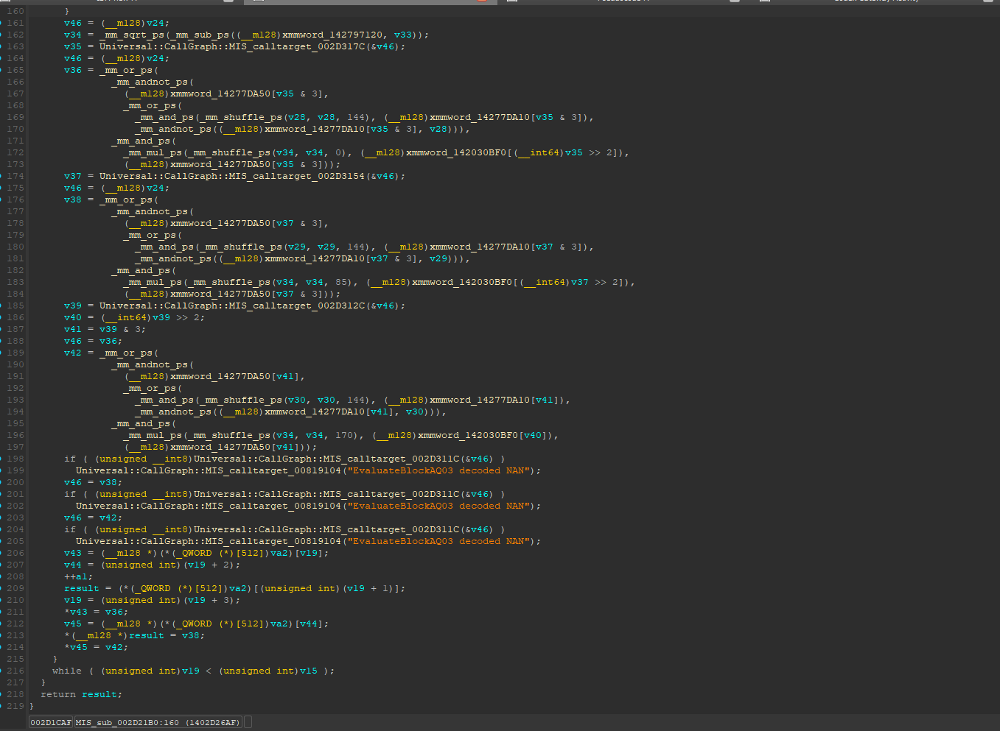
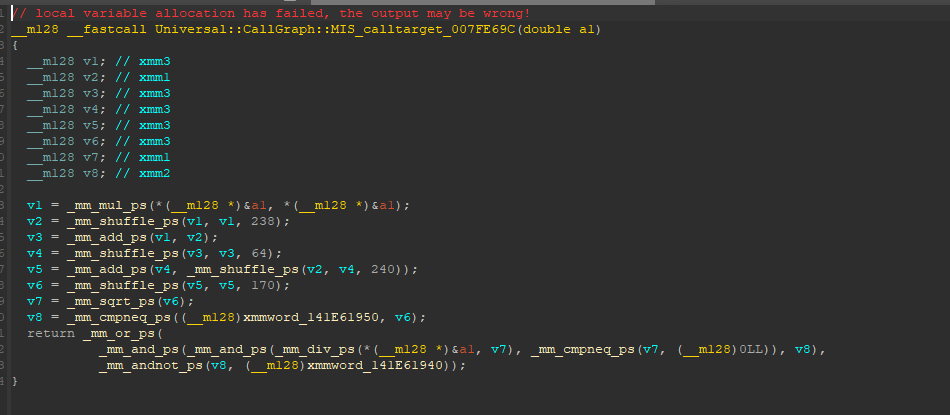

# Engine evidence (IDA)

Short decompiled excerpts from the PC executable (image base `0x140000000`, build analysed in October 2026), annotated with the
names used in the specification. The constants quoted below were read from the executable's data section.

## 1. Packed quaternion decode and the NaN assert: `0x1402D21B0` (SQ03 evaluator)

This is the inner loop of the SQ03 evaluator. AQ03 (`0x1402D26E0`) decodes its two bracketing key rows the same way.
**One iteration = one 16-byte word = three tracks** (`v19 += 3` until the track count `v15`).

| Line | What it does | Spec |
|---|---|---|
| 162 | `sqrt(ONE - dot)`, where `xmmword_142797120 = {1.0, 1.0, 1.0, 1.0}`. There is **no clamp**: a negative radicand gives NaN. | §5.1 |
| 163, 174, 185 | `MIS_calltarget_002D317C / 002D3154 / 002D312C` return the 3-bit metadata of slots 0, 1 and 2. | §5.1 |
| 167–173 | `xmmword_14277DA50[m & 3]` selects the lane that receives the reconstructed component: m = 0 → w, 1 → z, 2 → y, 3 → x. | §5.1 |
| 169–170 | `xmmword_14277DA10[m & 3]` with shuffle `144` shifts the stored components past the omitted lane, so they keep their x, y, z, w order. | §5.1 |
| 172 | `xmmword_142030BF0[m >> 2]` holds `+1.0` or `-1.0`: bit 2 negates the reconstructed component. | §5.1 |
| 172 / 183 / 196 | shuffles `0 / 85 / 170` broadcast the root of slot 0, 1 or 2. | |
| 198–205 | **all three slots** are NaN-checked through `MIS_calltarget_002D311C`, and a NaN calls `0x140819104` with `"EvaluateBlockAQ03 decoded NAN"`, a write to address 0. The message says AQ03 even in this SQ03 path, because the helper is shared. | §5.1 crash rule |
| 206–214 | the three results are written to the per-track output pointers `va2[v19 … v19+2]`. | |

Because the loop always processes whole words, the **unused slots of the last word are decoded and checked too**. That is why
they must hold the identity filler (`a = b = c = 4095`, metadata 0) and never zero bits.

## 2. Quaternion normalisation (the nlerp): `0x1407FE69C`

AQ03 interpolates between two keys with a normalised lerp, not a slerp. This is the normalisation step:

- `v1` to `v6`: the dot product of `q` with itself, summed and broadcast by shuffles.
- `v7 = sqrt(len²)`, then the function returns `q / len`, masked by `len != 0`, so a zero quaternion stays zero.
- `xmmword_141E61950 = {+inf, +inf, +inf, +inf}`: when `len²` is infinite, the result is replaced by `xmmword_141E61940 = {NaN, NaN, NaN, NaN}`, which the finite check that follows then catches.

See §5.3 of the specification for the full evaluation order: clamp to the key range, bracketing keys, sign flip for the shortest path, lerp, then this normalisation.
